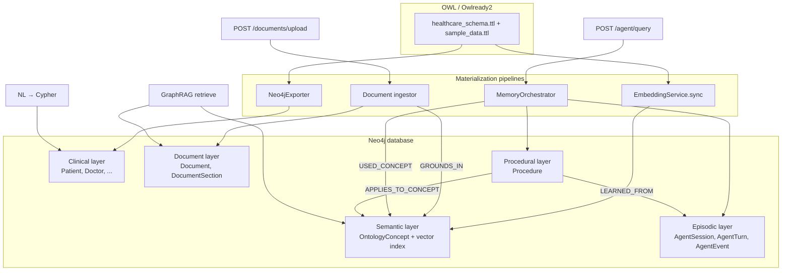

# Neo4j Graph Schema Design

This document describes how the Healthcare Ontology Platform materializes knowledge in Neo4j. The graph is **not a single homogeneous model** — it combines five complementary layers that share one database (`NEO4J_DATABASE` in `.env`) but serve different runtime paths.

---

## 1. Design goals

| Goal | How the schema supports it |
|------|----------------------------|
| Query clinical individuals with Cypher | OWL individuals exported as typed nodes (`:Patient`, `:Doctor`, …) with object-property edges |
| Semantic search over ontology terms | `:OntologyConcept` nodes + vector index on `embedding` |
| GraphRAG over uploaded healthcare documents | `:Document` / `:DocumentSection` grounded to ontology via `[:GROUNDS_IN]` |
| Multi-agent episodic memory | `:AgentSession` / `:AgentTurn` / `:AgentEvent` linked to concepts used in retrieval |
| Multi-agent procedural memory | `:AgentProcedure` query templates learned from successful turns |
| Course / local dev simplicity | No separate tenant graph shell; tenant fields on document and agent nodes where needed |

**Source of truth for domain semantics:** `ontology/healthcare_schema.ttl` plus `data/sample_data.ttl` (merged by `core/dataset.py`, loaded via Owlready2 and rdflib). Neo4j is a **runtime projection** for graph queries, embeddings, and document grounding — not a replacement for the OWL file.

---

## 2. Architecture overview



---

## 3. Graph layers

### 3.1 Clinical domain layer (individuals & relationships)

**Created by:** `POST /neo4j/load` → `services/neo4j_exporter.py`, from the authoritative RDF via `services/graph_projection.py`. This layer is a **derived projection**: it can be rebuilt at any time and nothing flows back to RDF. Design and rationale: [docs/semantic-authority-and-graph-projection.md](docs/semantic-authority-and-graph-projection.md).

OWL **individuals** become `:Resource` nodes that carry **every asserted class and every superclass as a label** (a diagnosis is `:Diagnosis:Condition`). The stable identifier is the **IRI** (`iri`, unique); `name` (the IRI local name) is for display and convenient queries only. Multi-valued properties are lists; classes are `:OntologyClass` nodes linked by `SUBCLASS_OF`, and individuals link to their asserted classes with `INSTANCE_OF`.

**Node pattern**

```cypher
(:Patient { name: "patient_001", dateOfBirth: "...", ... })
(:Doctor { name: "doctor_001", ... })-[:HASSPECIALTY]->(:Specialty { name: "SpecialtyCardiology" })
```

| Aspect | Rule |
|--------|------|
| Label | First `is_a` class of the individual (fallback: `Entity`) |
| Key property | `name` (string, merge key) |
| Data properties | Set as **node properties** (`SET n.{propName} = $value`) |
| Object properties | Set as **typed relationships** `(:A)-[:{PROP_NAME_UPPER}]->(:B)` |

**Relationship naming:** object property names are uppercased in Cypher (e.g. `hasDiagnosis` → `[:HASDIAGNOSIS]` or `[:HAS_DIAGNOSIS]` depending on OWL property name casing in export — exporter uses `prop.name.upper()`).

**Example clinical subgraph**

```cypher
(p:Patient {name: "JohnDoe"})
  -[:HASDIAGNOSIS]->
(d:Diagnosis {name: "HypertensionDx"})
  -[:DIAGNOSEDBY]->
(doc:Doctor {name: "DrSmith"})
```

**Typical OWL classes** (from `scripts/generate_hc_ontology.py` / course ontology):

- People: `Patient`, `Practitioner` (`Doctor`, `Nurse`, …); specialty is the `hasSpecialty` relationship to a `Specialty` concept, not a subclass
- Care: `Encounter`, `Appointment`, `Condition`/`Diagnosis`, `Observation`, `Procedure`, `Treatment`, `Prescription`, `Medication`, `MedicalRecord`
- Facilities: `Hospital`, `Department`, `Ward`, `Room`, `Bed`
- Labs / billing: `LaboratoryTest`, `ImagingStudy`, `DiagnosticResult`, `InsurancePolicy`, `Invoice`, …

**Typical object properties** (examples):

- `hasDiagnosis`, `diagnosisForPatient`, `diagnosedBy`
- `hasAppointment`, `appointmentWithDoctor`, `appointmentForPatient`
- `prescribedBy`, `prescribedFor`, `containsMedication`
- `worksInDepartment`, `hasMedicalRecord`, `admittedTo`

This layer is what **NL → Cypher** and Streamlit “Generate & run Cypher” target when answering questions about patients, doctors, and clinical facts in the graph.

---

### 3.2 Semantic ontology layer (`OntologyConcept`)

**Created by:** `POST /embedding/sync` → `services/embedding_service.py`

OWL **classes** (not individuals) are embedded and stored as semantic retrieval nodes.

**Node pattern**

```cypher
(:OntologyConcept {
  name: "Patient",           // OWL class name — merge key
  embedding: [0.12, ...]    // 1536-dim vector (OpenAI text-embedding-3-small)
})
```

| Property | Description |
|----------|-------------|
| `name` | OWL class name (unique merge key in practice) |
| `embedding` | Float array from the OpenAI embedding model (`OPENAI_EMBEDDING_MODEL`) |

**Embedded text** is built from class annotations: label, comment, parent classes (`is_a`), and related object properties where the class is in the property domain (`extract_annotations()`).

**Vector index**

```cypher
CREATE VECTOR INDEX ontology_embeddings IF NOT EXISTS
FOR (n:OntologyConcept) ON (n.embedding)
OPTIONS {
  indexConfig: {
    `vector.dimensions`: 768,
    `vector.similarity_function`: 'cosine'
  }
}
```

**Query pattern**

```cypher
CALL db.index.vector.queryNodes('ontology_embeddings', $top_k, $query_embedding)
YIELD node, score
RETURN node.name AS name, score
```

Used by:

- `GET /embedding/search`
- Hybrid retrieval (`enterprise/hybrid_retrieval.py`)
- Document grounding (`services/document_ingestor.py`)
- Agent semantic memory (`agents/memory/semantic.py` via hybrid retrieve)

**Important:** `:OntologyConcept` nodes represent **schema / terminology** (classes). They are **not automatically linked** to `:Patient` individual nodes unless you add that in a future materializer. Clinical queries use class-labeled individuals; semantic search uses `OntologyConcept`.

---

### 3.3 Document GraphRAG layer

**Created by:** `POST /documents/upload` → `services/document_ingestor.py`

Uploaded healthcare documents (txt, md, docx, best-effort pdf) are chunked and grounded to ontology concepts.

**Nodes**

```cypher
(:Document {
  document_id: string,      // UUID — merge key
  title: string,
  filename: string,
  content_type: string,
  tenant_id: string,
  ontology_id: string,      // e.g. hc-core
  ontology_version: string,
  source_type: string,      // e.g. uploaded
  created_at: string        // ISO-8601
})

(:DocumentSection {
  section_id: string,       // UUID — merge key
  document_id: string,
  tenant_id: string,
  ontology_id: string,
  ontology_version: string,
  chunk_index: int,
  content: string           // chunk text
})
```

**Relationships**

```cypher
(:Document)-[:HAS_SECTION]->(:DocumentSection)
(:DocumentSection)-[:GROUNDS_IN {
  confidence_score: float,  // vector similarity score
  grounding_method: "embedding"
}]->(:OntologyConcept)
```

**Grounding algorithm (per chunk)**

1. Embed chunk text (same embedding model as ontology sync).
2. Vector search top-k `OntologyConcept` nodes.
3. Create `GROUNDS_IN` edges for matches above `grounding_min_score`.

**Retrieval path** (`POST /documents/graphrag/retrieve`)

1. Embed user query → top ontology concepts.
2. Traverse backward from matched concepts to document sections:

```cypher
MATCH (ds:DocumentSection {tenant_id: $tenant_id})-[r:GROUNDS_IN]->(c:OntologyConcept)
WHERE c.name IN $concept_names
RETURN ds.section_id, ds.content, c.name, r.confidence_score
ORDER BY r.confidence_score DESC
LIMIT $limit
```

---

### 3.4 Episodic memory layer

**Created by:** LangGraph agent runs → `agents/memory/episodic.py` via `MemoryOrchestrator.commit_turn()` (`POST /agent/query`, resume, response node)

Stores **what happened** in past agent interactions: session turns, outcomes, trace events, and concept usage.

**Nodes**

```cypher
(:AgentSession {
  session_id: string,       // UNIQUE constraint
  tenant_id: string,
  user_id: string,
  created_at: string,
  updated_at: string,
  last_thread_id: string
})

(:AgentTurn {
  turn_id: string,          // UNIQUE constraint
  thread_id: string,
  question: string,
  answer: string,
  query_type: string,       // cypher | sparql | ontology_only
  draft_query: string,
  validated_query: string,
  status: string,           // completed | failed | rejected | refused
  confidence: float,
  refused: boolean,
  refusal_reason: string,
  created_at: string,
  archived: boolean,        // set by meta-memory archival (default false)
  archived_at: string,
  metadata_json: string     // JSON: plan, trace summary, provenance_path_count
})

(:SessionSummary {
  summary_id: string,
  summary_text: string,       // compact archive of older turns
  archived_turn_count: int,
  created_at: string
})

(:AgentEvent {
  event_id: string,         // UNIQUE constraint
  type: string,             // memory_assembled | trace | semantic_enriched | ...
  payload_json: string,
  created_at: string
})
```

**Relationships**

```cypher
(:AgentSession)-[:HAS_TURN]->(:AgentTurn)
(:AgentSession)-[:HAS_SUMMARY]->(:SessionSummary)
(:AgentTurn)-[:HAS_EVENT]->(:AgentEvent)
(:AgentTurn)-[:USED_CONCEPT]->(:OntologyConcept)   // optional, when concept was retrieved
```

**Constraints** (created on startup via `EpisodicMemoryStore.ensure_schema()`)

```cypher
CREATE CONSTRAINT agent_session_id IF NOT EXISTS
FOR (s:AgentSession) REQUIRE s.session_id IS UNIQUE;

CREATE CONSTRAINT agent_turn_id IF NOT EXISTS
FOR (t:AgentTurn) REQUIRE t.turn_id IS UNIQUE;

CREATE CONSTRAINT agent_event_id IF NOT EXISTS
FOR (e:AgentEvent) REQUIRE e.event_id IS UNIQUE;
```

**Read paths**

| API / method | Purpose |
|--------------|---------|
| `GET /agent/memory/{session_id}` | Recent Q/A summary for a session |
| `GET /agent/memory/episodes/search?q=` | Keyword overlap search over past successful turns |
| `EpisodicMemoryStore.load_context()` | Injected into working context by `memory_load` node |
| `EpisodicMemoryStore.search_similar_episodes()` | Similar past queries with `validated_query` |

Episodic memory provides **prior conversation context** and **similar-episode hints** to the planner/query nodes. It does not store Cypher result rows as graph structure.

**Meta-memory archival:** when a session exceeds `META_MEMORY_SESSION_ARCHIVE_TURNS`, `MetaMemoryController.post_turn()` creates a `SessionSummary`, sets `archived=true` on older turns (audit-safe), and keeps the most recent turns in hot recall. See `agents/memory/meta_memory.py`.

---

### 3.5 Procedural memory layer

**Created by:** `ProceduralMemoryStore.learn_from_turn()` after successful agent runs (`PROCEDURAL_AUTO_LEARN=true`, `confidence >= PROCEDURAL_MIN_CONFIDENCE`)

Stores **how to do things**: reusable query templates and plan steps learned from high-confidence successful turns.

**Node pattern**

```cypher
(:AgentProcedure {
  procedure_id: string,       // UNIQUE constraint
  tenant_id: string,          // or 'global'
  name: string,               // derived from question tokens
  query_type: string,         // cypher | sparql
  intent_keywords: string,    // JSON array of question tokens
  template_query: string,     // validated Cypher/SPARQL from source turn
  plan_steps_json: string,    // JSON array of plan steps
  success_count: int,
  avg_confidence: float,
  created_at: string,
  last_used_at: string
})
```

**Relationships**

```cypher
(:AgentProcedure)-[:LEARNED_FROM]->(:AgentTurn)
(:AgentProcedure)-[:APPLIES_TO_CONCEPT]->(:OntologyConcept)
```

**Constraint**

```cypher
CREATE CONSTRAINT procedure_id IF NOT EXISTS
FOR (p:AgentProcedure) REQUIRE p.procedure_id IS UNIQUE;
```

**Read paths**

| API / method | Purpose |
|--------------|---------|
| `GET /agent/memory/procedures?q=` | Lexical match against procedure names/keywords |
| `ProceduralMemoryStore.match_procedures()` | Called by `memory_load` node |
| Query node | Reuses `template_query` directly when `match_score >= 0.85` |

**Learn path:** On `status=completed` with `validation_ok` and sufficient confidence, the orchestrator generalizes the `validated_query` into a procedure (merge by `tenant_id` + `name`, increment `success_count`).

---

### 3.6 Working memory (runtime, not persisted as graph nodes)

Working memory is **not a Neo4j layer** — it lives in `AgentState` and the LangGraph checkpointer for the duration of a thread:

| Field | Role |
|-------|------|
| `working_context` | Compacted prompt block (question + procedures + semantics + episodic + repair) |
| `working_events` | Append-only events for the current turn |
| `memory_bundle` | Structured slice: `{episodic, procedural, semantic}` |

Compaction is performed by `agents/memory/working.py` (`compact_working_context`) with a char budget (`WORKING_MEMORY_MAX_CHARS`, default 6000).

---

## 4. Cross-layer interactions

| From | To | Link | Purpose |
|------|-----|------|---------|
| `DocumentSection` | `OntologyConcept` | `GROUNDS_IN` | GraphRAG: document evidence tied to ontology terms |
| `AgentTurn` | `OntologyConcept` | `USED_CONCEPT` | Trace which concepts informed an agent answer |
| `Procedure` | `AgentTurn` | `LEARNED_FROM` | Provenance: which turn taught the procedure |
| `Procedure` | `OntologyConcept` | `APPLIES_TO_CONCEPT` | Procedure scoped to ontology terms |
| Clinical individuals | `OntologyConcept` | **none (today)** | Class names overlap by string only |
| Hybrid retrieval | Clinical graph | Ad-hoc Cypher | Neighborhood expansion matches any `n` where `n.name` in seed set |

Hybrid retrieval (`enterprise/hybrid_retrieval.py`) may expand neighborhoods with a generic pattern:

```cypher
MATCH (n) WHERE n.name = 'Patient' OR n.name = 'Hypertension'
OPTIONAL MATCH (n)-[r]-(m)
RETURN n.name, type(r), m.name
```

That reads the **clinical layer** (and any other node with a `name` property), not `OntologyConcept` structure.

---

## 5. Indexes and constraints summary

| Name | Type | Target | Created by |
|------|------|--------|------------|
| `ontology_embeddings` | Vector index | `OntologyConcept.embedding` | `EmbeddingService.create_vector_index()` |
| `agent_session_id` | Uniqueness | `AgentSession.session_id` | `EpisodicMemoryStore.ensure_schema()` |
| `agent_turn_id` | Uniqueness | `AgentTurn.turn_id` | `EpisodicMemoryStore.ensure_schema()` |
| `agent_event_id` | Uniqueness | `AgentEvent.event_id` | `EpisodicMemoryStore.ensure_schema()` |
| `procedure_id` | Uniqueness | `Procedure.procedure_id` | `ProceduralMemoryStore.ensure_schema()` |

Clinical nodes rely on `MERGE (n:Label {name: ...})` without declared constraints in code today.

---

## 6. Multi-tenancy in the graph

| Layer | Tenant isolation |
|-------|------------------|
| `Document` / `DocumentSection` | `tenant_id`, `ontology_id`, `ontology_version` properties; retrieval filters `tenant_id` |
| `OntologyConcept` | **Global** per database (not tenant-scoped in current schema) |
| Clinical individuals | **Global** (course/demo default) |
| `AgentSession` / `AgentTurn` / `AgentEvent` | `tenant_id` on session; filtered in episodic queries |
| `Procedure` | `tenant_id` property; `global` procedures shared across tenants |

Enterprise HTTP APIs scope documents to the authenticated identity's tenant; ontology embeddings and clinical export are shared within the Neo4j database.

---

## 7. Materialization workflows

| Step | API / script | Graph effect |
|------|----------------|--------------|
| 1 | Load OWL (automatic on API start) | Owlready2 in memory only |
| 2 | `POST /neo4j/load` | Clinical projection (individuals, classes, relationships) |
| 3 | `POST /embedding/sync` | `OntologyConcept` + vector index |
| 4 | `POST /documents/upload` | `Document`, `DocumentSection`, `GROUNDS_IN` |
| 5 | `POST /agent/query` | `AgentSession`, `AgentTurn`, `AgentEvent`, optional `USED_CONCEPT`, optional `Procedure` |

Recommended first-time order: **export → embedding sync → document upload → agent / GraphRAG queries**.

---

## 8. Example exploration queries

**Count nodes by label**

```cypher
MATCH (n)
RETURN labels(n) AS labels, count(*) AS cnt
ORDER BY cnt DESC;
```

**Clinical: patients with a diagnosis name containing “Hypertension”**

```cypher
MATCH (p:Patient)-[:HASDIAGNOSIS]->(d:Diagnosis)
WHERE d.name CONTAINS 'Hypertension' OR p.name CONTAINS 'Hypertension'
RETURN p.name, d.name
LIMIT 25;
```

**Semantic: top concepts for a query embedding** (via API preferred)

```http
GET /embedding/search?query=diabetes&top_k=5
```

**GraphRAG: grounded document sections for a tenant**

```cypher
MATCH (ds:DocumentSection {tenant_id: 'default'})-[r:GROUNDS_IN]->(c:OntologyConcept)
WHERE c.name IN ['Patient', 'Medication', 'Hypertension']
RETURN ds.document_id, ds.chunk_index, c.name, r.confidence_score, ds.content
ORDER BY r.confidence_score DESC
LIMIT 10;
```

**Agent: recent turns for a session**

```cypher
MATCH (s:AgentSession {session_id: $sid})-[:HAS_TURN]->(t:AgentTurn)
RETURN t.question, t.answer, t.query_type, t.validated_query, t.confidence, t.created_at
ORDER BY t.created_at DESC
LIMIT 5;
```

**Agent: events for a turn**

```cypher
MATCH (t:AgentTurn {turn_id: $turn_id})-[:HAS_EVENT]->(e:AgentEvent)
RETURN e.type, e.payload_json, e.created_at
ORDER BY e.created_at;
```

**Procedural: top procedures for a tenant**

```cypher
MATCH (p:AgentProcedure)
WHERE p.tenant_id = $tenant_id OR p.tenant_id = 'global'
RETURN p.name, p.query_type, p.template_query, p.success_count, p.avg_confidence
ORDER BY p.success_count DESC
LIMIT 10;
```

**Procedural: concepts a procedure applies to**

```cypher
MATCH (p:AgentProcedure {name: $name})-[:APPLIES_TO_CONCEPT]->(c:OntologyConcept)
RETURN p.name, c.name;
```

**Vector index health**

```cypher
SHOW VECTOR INDEXES
YIELD name, type, labelsOrTypes, properties, options
WHERE type CONTAINS 'VECTOR';
```

---

## 9. Design trade-offs and future extensions

**Current choices**

- **Dual node models for “Patient”:** `:Patient` (individual) vs `:OntologyConcept {name: "Patient"}` (class embedding) — simple for teaching, but names can confuse newcomers.
- **Document grounding targets concepts only** — not clinical individuals; answers about uploaded PDFs flow through section text + ontology labels, not patient nodes.
- **No `OntologyVersion` / `Resource` shell** (unlike enterprise FinOps GraphRAG in CBA) — versioning is carried as properties on document nodes.
- **PDF extraction** is best-effort without `pypdf`; scanned PDFs may yield empty chunks.

- **Episodic similarity** uses keyword overlap — no vector index on `AgentTurn.question` yet.
- **Procedure auto-learn** only from successful, validated turns above confidence threshold.
- **Working memory** is in-process (`AgentState` + LangGraph checkpointer), not in Neo4j.

**Possible extensions**

- Vector index on `AgentTurn.question` or `Procedure.intent_embedding` for semantic procedure/episode matching
- `(:OntologyConcept)-[:REPRESENTS_CLASS]->(:Patient)` merge key linking semantic and clinical layers
- Typed ontology edges in Neo4j (`SUB_CLASS_OF`, `HAS_OBJECT_PROPERTY`) for graph expansion
- Tenant-scoped `OntologyConcept` nodes and per-tenant vector indexes
- `KnowledgeSource` / `DocumentConcept` intermediate nodes (full CBA-style graph) if grounding metadata needs richer provenance

---

## 10. Source file reference

| Component | File |
|-----------|------|
| Clinical export | `services/neo4j_exporter.py` |
| OWL → Cypher snippets | `services/load_ontology.py` |
| OntologyConcept + vector index | `services/embedding_service.py` |
| Document GraphRAG | `services/document_ingestor.py` |
| Document API | `routers/documents.py` |
| Hybrid retrieval | `enterprise/hybrid_retrieval.py` |
| Memory orchestrator | `agents/memory/orchestrator.py` |
| Episodic memory | `agents/memory/episodic.py` |
| Procedural memory | `agents/memory/procedural.py` |
| Semantic memory | `agents/memory/semantic.py` |
| Working memory | `agents/memory/working.py` |
| Memory load node | `agents/nodes/memory_load.py` |
| OWL schema generation | `scripts/generate_hc_ontology.py` (schema), `scripts/generate_sample_data.py` (instances) |
| Config | `core/config.py`, `.env` (`NEO4J_DATABASE`, `ONTOLOGY_SCHEMA_FILE`, `SAMPLE_DATA_FILE`) |

---

## 11. Related documentation

- [system_design.md](system_design.md) — platform architecture and API categories  
- [readme.md](readme.md) — setup, embedding sync, Neo4j configuration  
- [COURSE_SETUP.md](COURSE_SETUP.md) — student step-by-step environment setup
